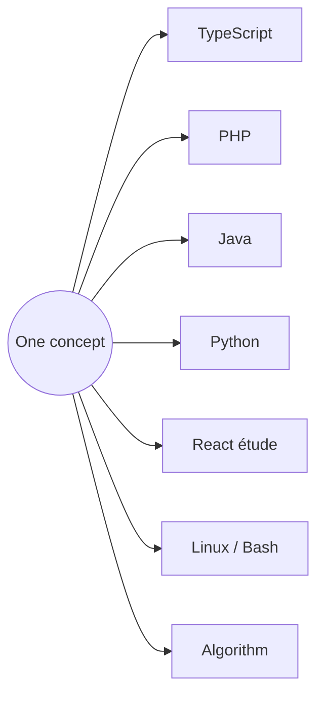

# 🎹 Polyglotte — a conservatory for code

> **One concept. Four instruments.**
> A former concert pianist learns to code the way he learned the piano: daily scales, études, and one repertoire piece, practised in every key.


---

## 🎼 The idea

A pianist practises the same scale in all twelve keys until the *idea* of the scale is independent of the key.
I do the same with code: every concept is written once in **TypeScript**, then transposed into **PHP**, **Java** and **Python**, applied in a **React** étude, and practised on **Linux**.

The goal: separate what is *universal* in programming from what is *just syntax*, and think like a software architect.



## ▶️ See it play

One command runs the same exercise in all four languages:

```text
$ ./play.sh algo 03          # format 185 seconds as m:ss
── TypeScript   3:05
── PHP          3:05
── Java         3:05
── Python       3:05
```

## 🔍 Same idea, different answers

What comparing four languages side by side reveals:

| Question | TypeScript | PHP | Java | Python |
|---|---|---|---|---|
| `7 / 2` | `3.5` | `3.5` | **`3`** (int ÷ int) | `3.5` (`//` gives `3`) |
| `0.1 + 0.2` | `0.30000000000000004` | same | same | same: it's the CPU, not the language |
| A changed constant is caught… | by `tsc`, or at runtime | before running | at compile time | **never**, only by a type checker |

## 🗂️ Structure

```text
scales/          one concept per session
  ts/ php/ java/ python/    the four instruments
  react/                    études: the concept, in a web page
  linux/                    Linux & Bash practice (LFCA → LFCS path)
  algorithms/               pseudo-code first, then code
repertoire/      the main piece: one React front end,
                 the same API built four times
                 (Express · Symfony · Spring Boot · FastAPI),
                 one PostgreSQL database
play.sh          run any exercise in the four languages
journal.md       practice log
```

## 📈 Progress

| # | Concept | Voices | PR |
|---|---|---|---|
| 00 | Hello world | TS · PHP · Java · Python | — |
| 01 | Constants and variables | TS · PHP · Java · Python | — |
| 02 | Basic types | 4 languages · React · algo 02 | #1 |
| 03 | Arithmetic operators | 4 languages · React · algo 03 · Linux | #2 · in progress |

## 🎹 Method

- **One number per session**, shared by every voice. A lagging voice is caught up before moving on.
- **Prediction first**: guess the output, then run.
- **Wrong notes on purpose**: break the code to see how each language reacts.
- **Professional workflow**: one branch per session (`feature/NN-topic`), Conventional Commits, reviewed pull requests, decisions recorded as ADRs.

## 👤 About

Former concert pianist (20 years on stage), now training as a software developer at **Ada Tech School** (Lyon), on the path to **software architecture**, cloud and DevSecOps.